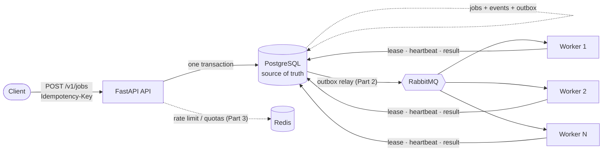

<div align="center">

# ⚒️ Foundry

**A production-style distributed job processing platform.**
Submit long-running jobs over REST. A fleet of workers executes them reliably — surviving crashes, retries, and duplicate deliveries without duplicate side effects.


</div>

---

## Why this exists

Most "AI demos" are a model behind an endpoint. Real systems are mostly **failure handling**: a worker dies mid-job, a client retries a request, a message is delivered twice, a queue backs up. Foundry is built around those problems first.

> **Demo goal:** run a load test, `kill -9` a worker mid-processing, and watch every job recover — with zero duplicate side effects.

## Build status

| Part | Scope | Status |
|-----:|-------|:------:|
| 1 | Schema, auth, REST API, idempotency, dedup, transactional outbox, Docker stack | ✅ **done** |
| 2 | Workers, RabbitMQ, retries + exponential backoff, timeouts, dead-letter queue, lease reaper | ⏳ |
| 3 | Rate limiting, per-user quotas, Prometheus metrics, Grafana dashboards | ⏳ |
| 4 | Load tests, chaos / worker-crash recovery tests, exactly-once-effect proof | ⏳ |
| 5 | Kubernetes manifests, CI polish, architecture docs, final demo | ⏳ |

## Architecture



**Key idea:** PostgreSQL owns *state*; the broker only carries *hints that work exists*. If the broker loses every message, the outbox and the lease reaper rebuild them. If a worker dies, its lease expires and another worker takes over.

## What Part 1 gives you

- **Authenticated REST API** — API keys stored as `HMAC-SHA256(pepper, secret)`, constant-time compare, key rotation, tier-based limits.
- **Idempotent submission** — `Idempotency-Key` header. Same key + same request → the original job. Same key + *different* request → `422`. Enforced by a unique index, so it holds under 25 concurrent retries (tested).
- **Opt-in deduplication** — `"deduplicate": true` collapses identical *active* jobs; the slot frees automatically when the job finishes (partial unique index).
- **Transactional outbox** — the job row, its audit event, and its "run me" message commit atomically. No dual-write bug.
- **Strict state machine** — `queued → running → succeeded | retry_scheduled | dead | cancelled`, encoded once and tested.
- **Payload validation + SSRF guard** — typed schemas per job type, normalized so equivalent requests hash equally.
- **Keyset pagination**, per-job **audit trail**, RFC 9457 `problem+json` errors, request IDs, structured JSON logs.
- **Schema migrations** with an advisory lock, safe for many replicas starting at once.

## Quickstart

```bash
docker compose up --build -d          # Postgres, Redis, RabbitMQ, API
open http://localhost:8000/docs        # interactive OpenAPI
make demo                              # scripted walkthrough of idempotency + dedup
```

Or step by step:

```bash
# 1. create a user (admin token from docker-compose / .env)
curl -s -X POST localhost:8000/v1/admin/users \
  -H "X-Admin-Token: dev-admin-token-change-me" -H 'Content-Type: application/json' \
  -d '{"email":"you@example.com","name":"You","tier":"pro"}'
# -> {"user": {...}, "api_key": "fnd_ab12cd34_..."}   (shown once)

# 2. submit a job, safely retryable
curl -i -X POST localhost:8000/v1/jobs \
  -H "Authorization: Bearer $KEY" -H "Idempotency-Key: invoice-2026-10-26" \
  -H 'Content-Type: application/json' \
  -d '{"type":"video.transcode","payload":{"source_url":"https://example.com/in.mp4","preset":"1080p"},"priority":7}'

# 3. watch it
curl -s localhost:8000/v1/jobs/$JOB_ID        -H "Authorization: Bearer $KEY"
curl -s localhost:8000/v1/jobs/$JOB_ID/events -H "Authorization: Bearer $KEY"
```

## API surface

| Method & path | Purpose |
|---|---|
| `POST /v1/jobs` | Submit a job (`Idempotency-Key`, `deduplicate`, `priority`, `max_attempts`, `timeout_seconds`) |
| `GET /v1/jobs` | List your jobs, newest first, keyset-paginated, `?status=` filter |
| `GET /v1/jobs/{id}` · `/events` | Job state · audit trail of every transition |
| `POST /v1/jobs/{id}/cancel` | Immediate for queued jobs, cooperative (`202`) for running ones |
| `GET /v1/job-types` | Discover job types and their JSON-Schema payloads |
| `GET /v1/me` | Your tier and limits |
| `POST /v1/admin/users` · `/users/{id}/api-keys` | Provision users, rotate keys (admin token) |
| `GET /healthz` · `/readyz` | Liveness · readiness (checks PostgreSQL) |

Job types: `document.convert`, `video.transcode`, `ml.inference`, `demo.sleep` (synthetic, for load/chaos tests).

## Development

```bash
make install        # editable install + dev tools
make infra          # just the backing services
make dev            # API with auto-reload
make test           # 73 tests: unit + integration (real PostgreSQL, no mocks)
make lint
```

Integration tests need PostgreSQL; point them at one with `FOUNDRY_TEST_DATABASE_URL`
(default `postgresql://postgres@localhost:5433/foundry_test`). They are skipped if it is unreachable.

## Project layout

```
src/foundry/
  api/            FastAPI app, routes, auth dependency
  service.py      submission / cancellation: idempotency + dedup + atomicity
  repository.py   every SQL statement lives here
  domain.py       state machine, tier limits, canonical hashing
  jobtypes.py     payload schemas + per-type defaults (extend here)
  security.py     API key generation and verification
  migrations/     ordered SQL migrations
docs/adr/         architecture decision records
tests/            unit + integration
```

## Design decisions

Short ADRs in [`docs/adr`](docs/adr): PostgreSQL as the source of truth, the transactional outbox, and idempotency semantics.
