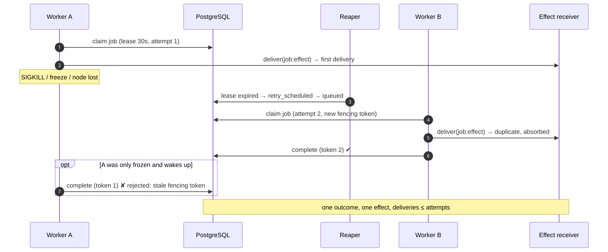

# Architecture

**Principle: PostgreSQL is the source of truth; the broker only carries hints.** Losing every
RabbitMQ message is a latency event, not a data-loss event, because the reaper redrives stale
queued jobs from Postgres.

## Request path
1. The API authenticates, applies the Redis token bucket and daily quota, and checks the
   per-user concurrency limit under a `pg_advisory_xact_lock`.
2. One transaction writes the job, its first event and an outbox row. `Idempotency-Key`
   (unique index plus request fingerprint) makes retries safe; opt-in dedup rejects identical
   active jobs.
3. The relay (`LISTEN/NOTIFY` wake-up, `FOR UPDATE SKIP LOCKED`, publisher confirms,
   `mandatory=True`) publishes to RabbitMQ.
4. A worker receives the hint and **claims** the job in Postgres: lease + `attempts` as a
   fencing token. Every later write is guarded by `status='running' AND lease_owner=me AND
   attempts=my_attempt`.

## Job lifecycle

Retries are *row state* (`retry_scheduled` + `next_run_at`, equal-jitter exponential backoff),
not broker delays, so they survive restarts and are visible in SQL. Exhausted or permanent
failures go to `dead` (+ dead-letter queue + replay endpoint).

## What happens when a worker dies

| fault | detection | recovery | duplicate side effects? |
|---|---|---|---|
| worker SIGKILL / node loss | lease expires | reaper schedules retry, another worker claims | possible repeat *delivery*, absorbed by idempotent receiver |
| worker frozen then resumed (zombie) | lease expires | re-claimed; zombie's writes fail the fencing guard | same |
| SIGTERM (deploy, scale-down) | immediate | in-flight jobs released, no attempt burned | no |
| RabbitMQ down | relay publish fails | outbox rows wait in Postgres; relay retries forever (infra errors don't count toward the poison cap) | no |
| relay/reaper killed | other replica / restart | `SKIP LOCKED` makes replicas safe | no |
| Redis down | limiter errors | fail-open (availability over strictness) | no |

## Guarantees
- **At-least-once execution**, **exactly-once effect** via an idempotent receiver. Proven per
  run by `foundry audit`, not asserted.
- Every state change is a legal edge of the state machine, recorded in `job_events`.
- Per-user fairness: rate limit, daily quota, exact concurrency cap.

## Components
| process | scale | notes |
|---|---|---|
| `api` | HPA on CPU | stateless; exposes DB-derived gauges at scrape time |
| `worker` | HPA on CPU, or KEDA on backlog | `terminationGracePeriodSeconds` > drain grace |
| `relay`, `reaper` | 2 replicas for HA | safe to run many |
| PostgreSQL / Redis / RabbitMQ | managed services in prod | dev overlay ships throwaway ones |

Decisions are recorded in [docs/adr](adr/).
